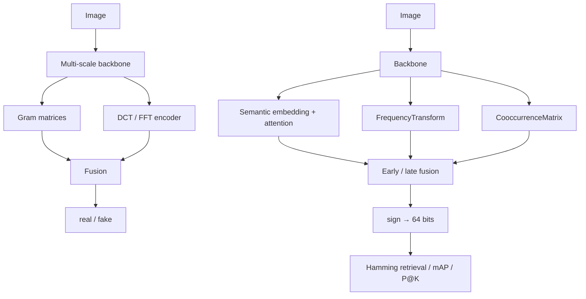

# Synthetic Image Forensics · Gram Texture Features + Multi-Feature Hashing

**English** | [简体中文](README.md)


> Two tasks, one backbone: **tell whether an image was generated by AI**, and **compress an image
> into a 64-bit binary code for fast retrieval**. Both exploit the same idea — generative models
> leave systematic traces in high-frequency / texture statistics, and those statistics are exactly
> what a robust hash should be insensitive to.

## Why Gram matrices

Generative artefacts are nearly invisible in pixel space but show up in **second-order statistics**.
A Gram matrix is the channel-wise covariance of a feature map:

```
F (C×H×W)  →  G = F·Fᵀ / (H·W)     # C×C channel correlation
```

Stacking Gram statistics at multiple scales keeps low-frequency semantics while amplifying
high-frequency texture deviation. The detection branch fuses those with a frequency-domain encoder
and a semantic embedding before a shallow classifier — no need for a deeper, heavier backbone.

The hashing branch reuses the intuition: features that are robust to texture statistics are good
candidates for "same image under different transformations" retrieval. Semantic embedding, DCT
frequency features and gray-level co-occurrence (GLCM) are fused, compressed to a binary code, and
ranked by Hamming distance, scored with mAP / Precision@K.

## Architecture



`synthetic_detector/models/detector.py` contains `MultiFeatureDetector`, a beefier variant that runs
frequency, semantic, hash and co-occurrence encoders in parallel, combines them through CBAM
attention and a cross-feature interaction block, and supports temperature calibration and
per-feature importance analysis.

## Layout

```
models/gram_detection/    Gram modules, detector, texture-triplet / focal losses
models/hash/              Semantic embedding, frequency + GLCM fusion, hash network
train/  evaluate/  demo/  Training, evaluation and single-image demos
synthetic_detector/       Unified CLI: dataset prep, training, feature-contribution analysis
hashkit/                  ★ Framework-free retrieval metrics (numpy only, unit-tested)
tests/                    Unit tests
docs/                     Requirements and design notes
```

## Quick start

```bash
git clone https://github.com/DOUFUQAQ/synthetic-image-forensics.git
cd synthetic-image-forensics
pip install -r requirements.txt            # install torch matching your CUDA first
pip install -r requirements-dev.txt        # optional: tests + lint
```

```bash
python train/train_detector.py --data_dir data/ --batch_size 32 --epochs 50
python demo/demo_detector.py --image_path some.jpg --checkpoint checkpoints/detector.pth

python train/train_hash.py --data_dir data/ --hash_size 64 --batch_size 32 --epochs 50
python evaluate/evaluate_hash.py --checkpoint checkpoints/hash_net.pth \
    --database_dir data/database/ --query_dir data/query/

python -m unittest discover -s tests -t .   # 15 tests, numpy only
```

## About `hashkit`

`get_binary_hash_codes` / `compute_hamming_distance` / `compute_map` used to be copy-pasted across
five scripts with subtly different conventions, all torch-dependent. That made bit-length
experiments hard to compare and the metrics impossible to test in isolation.

`hashkit` re-implements them in numpy as the single source of truth and is covered by tests that
compare against a naive double-loop reference (including a check that the chunked distance path
matches the monolithic one).

## Limitations

- Gram matrices are `C×C`: channel-heavy backbones blow up memory, hence the downsampled multi-scale
  features and pre-fusion normalisation.
- `sign()` is not differentiable; training approximates quantisation with `tanh`, a standard
  hashing-learning trade-off rather than a contribution of this repo.
- Cross-generator generalisation (train on GAN, test on diffusion) has not been systematically
  evaluated, so no headline metrics are claimed here.
- Two implementations coexist (`models/` vs `synthetic_detector/`); merging them is on the roadmap.

## Roadmap

- [x] Extract framework-free, unit-tested metrics (`hashkit`)
- [ ] Merge the two implementations
- [ ] Migrate training/evaluation scripts to the `hashkit` conventions
- [ ] Cross-generator generalisation study
- [ ] CPU forward-shape tests + CI

## License

[MIT](LICENSE) © 2025 DOUFUQAQ
