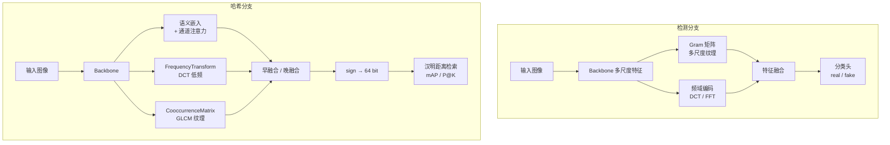

# 图像鉴伪与哈希检索 · Gram 纹理特征 + 多特征哈希网络

[English](README.en.md) | **简体中文**


> 两个任务、一套骨架：**识别一张图是不是 AI 生成的**，以及**把图压成 64 bit 二进制码做快速检索**。
> 两者共享同一套「频域 + 纹理 + 语义」的多特征建模思路——生成模型留下的痕迹主要在
> 高频统计特性上，而哈希想要的是对这些统计特性鲁棒的二值编码。

---

## 一条主线：为什么用 Gram 矩阵

生成模型（GAN / 扩散）在像素层面几乎无法用肉眼分辨，但它对**图像二阶统计量**的建模并不完美：
真实图像的纹理在多个尺度上呈现稳定的空间相关性，而生成图像在 Gram 矩阵（特征图通道间的
协方差）上会出现系统性偏差，尤其是在中高频。

所以检测分支不去堆更深的分类器，而是**显式地把 Gram 统计量作为特征**：

```
特征图 F (C×H×W)  →  G = F·Fᵀ / (H·W)  →  通道间相关性 (C×C)
```

多尺度（不同层、不同感受野）的 Gram 矩阵拼接后，既保留了低频语义，又放大了高频纹理差异。
在此基础上再融合频域编码（DCT/FFT 幅值谱）与语义嵌入，用一个浅层分类头出结果。

哈希分支借用同一个直觉：**对纹理统计鲁棒的特征，天然适合做"同图不同变换"的检索**。
于是把语义嵌入、频域特征、灰度共生矩阵（GLCM）三路特征融合后压到二值码，
用汉明距离做检索，并以 mAP / Precision@K 衡量。

---

## 架构



另有 `synthetic_detector/models/detector.py` 中的 `MultiFeatureDetector`：
把频域编码器、语义编码器、ImageHash 编码器、共现编码器并联，经 CBAM 注意力
与跨特征交互模块后再分类，是上述思路的**加强版**（带特征权重可视化与温度校准）。

---

## 仓库结构

```
synthetic-image-forensics/
├── models/
│   ├── gram_detection/
│   │   ├── gram_module.py        # GramMatrix / MultiScaleGramModule / GramTextureExtractor
│   │   └── detector.py           # GramBasedDetector + TextureTripletLoss / FocalLoss
│   └── hash/
│       ├── semantic_module.py    # 语义嵌入 + 注意力 + 多级语义提取
│       ├── feature_fusion.py     # 频域变换 / 共生矩阵 / 早融合 / 晚融合
│       └── hash_net.py           # MultiFeatureHashNet + HashingLoss + mAP
├── utils/                        # 数据准备、指标、可视化、transforms
├── train/                        # train_detector.py / train_hash.py
├── evaluate/                     # 评测入口
├── demo/                         # 单图检测 / 检索演示
├── synthetic_detector/           # 加强版：统一 CLI + 数据集组织 + 特征贡献分析
│   └── run.py                    # download / prepare / train / evaluate / demo
├── hashkit/                      # ★ 新增：纯 numpy 的检索评测指标（带单测）
├── tests/                        # 单元测试
└── docs/                         # 需求与设计文档
```

---

## 快速开始

```bash
git clone https://github.com/DOUFUQAQ/synthetic-image-forensics.git
cd synthetic-image-forensics

# 有 GPU 时按自己的 CUDA 版本装 torch
pip install -r requirements.txt
pip install -r requirements-dev.txt     # 可选：测试与 lint
```

### 检测

```bash
# 组织数据集（真实图 / 生成图分目录）
python -m synthetic_detector.run prepare --help

# 训练 Gram 检测器
python train/train_detector.py --data_dir data/ --batch_size 32 --epochs 50

# 单图推理
python demo/demo_detector.py --image_path some.jpg --checkpoint checkpoints/detector.pth
```

### 哈希检索

```bash
python train/train_hash.py --data_dir data/ --hash_size 64 --batch_size 32 --epochs 50
python evaluate/evaluate_hash.py --checkpoint checkpoints/hash_net.pth --database_dir data/database/ --query_dir data/query/
python demo/demo_hash.py --image_path query.jpg --database_dir data/database/
```

### 评测指标（新增，可单测）

```bash
python -m unittest discover -s tests -t .   # 15 passed，只需要 numpy
```

---

## 为什么会有 `hashkit/`

这部分是后来补的，动机很实际：原脚本里 `get_binary_hash_codes` / `compute_hamming_distance` /
`compute_map` 在 5 个文件里各有一份，口径不完全一致，而且都依赖 torch——导致
「改个比特数」这种实验，很容易因为换了脚本而得出互相矛盾的数字，也没法单独测试。

`hashkit/` 用纯 numpy 重写这些指标，并把它当作唯一口径：

| 函数 | 作用 |
| --- | --- |
| `binary_hash_codes` | 连续输出 → 二值码（同时兼容 `{-1,1}` 与 `{0,1}` 输入） |
| `hamming_distance` / `hamming_matrix` | 分块计算距离矩阵，内存占用只与 `n_query × n_db` 同阶 |
| `precision_at_k` | Precision@K |
| `mean_average_precision` | mAP（无相关项的查询按惯例跳过） |
| `evaluate_retrieval` | 一次算出 mAP + 多档 P@K，距离矩阵只算一遍 |

测试用最朴素的 Python 双重循环作为对照实现，逐项比对，并额外验证了分块路径与整块路径等价。

---

## 设计取舍与已知局限

- **Gram 矩阵的代价**：`C×C` 的协方差对通道数敏感，通道一多就成了显存杀手；实际用的是多尺度
  下采样后的特征图，并在融合前做了归一化。
- **二值化的信息损失**：`sign()` 之后无法反向传播，训练时用 `tanh` + 量化损失近似，
  这是哈希学习里的常规折衷，不是本项目的创新。
- **数据依赖**：检测分支的效果高度依赖「真实图与生成图的分布差」。跨生成器（训练用 GAN、
  测试用扩散）的泛化能力尚未系统评测，README 里不写没有实测支撑的指标。
- **尚未统一**：`models/` 与 `synthetic_detector/` 两套实现并存，前者结构清晰、后者工程完整，
  合并工作列在 Roadmap 里。

## Roadmap

- [x] 抽出与框架解耦的评测模块 `hashkit` 并补齐单测
- [ ] 合并 `models/` 与 `synthetic_detector/` 两套实现
- [ ] 让 `train/` 与 `evaluate/` 脚本统一改用 `hashkit` 口径
- [ ] 补充跨生成器泛化实验（GAN 训练 → 扩散测试）
- [ ] 训练/推理脚本接入 CI（需要 GPU，先做 CPU 上的形状与前向测试）

## License

[MIT](LICENSE) © 2025 DOUFUQAQ
